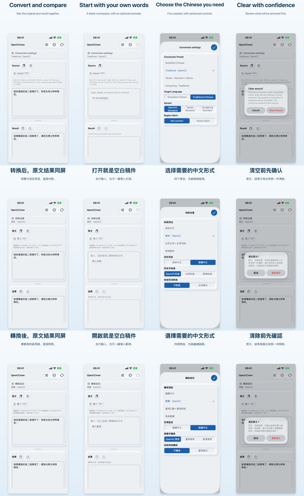

# 2.2 iPhone App Store screenshots and previews

Recorded 2026-10-31 for iOS version `a45ea7c1-95f5-48d6-93a1-b514da32bdb9`. Only the iPhone 6.7" set was replaced. iPad and Mac screenshots and previews were carried over from [2.1](../store-assets-2.1-20260929/README.md).

- **Source:** UI from `776accc`, whose app tree equals Build 63 source `15390dd`. The capture used a local unsigned Debug QA build (bundle `org.gewill.OpenCCman.WhatsNewUITests`) from Xcode 27.1, on a new iPhone 18 Pro Max simulator running iOS 27.0. Settings: light appearance, 9:41 status bar, each locale launched separately.
- **Uploaded:** four screenshots per locale (`01-converted`, `02-empty`, `03-presets`, `04-clear`) and one preview per locale (`01-convert-and-clear`).
- **ASC readback:** all items `COMPLETE`, and each screenshot's `sourceFileChecksum` equals its local MD5. Order is 01–04. See `ascReadback` in [manifest.json](manifest.json) and the `upload-*.json` readbacks; local file paths were removed from those.
- **Rendering:** `scripts/store-assets/render-marketing-screenshots.swift`, then a lossless RGB flatten. Capture and preview encoding inputs are [capture-iphone-2.2.swift](capture-iphone-2.2.swift), [encode-iphone-previews.py](encode-iphone-previews.py) and [iphone-preview-edits.json](iphone-preview-edits.json).

The contact sheet is a downscaled JPEG for review only. Full-size marketing PNGs and MP4s are 9.4 MB, and raw captures 55 MB. They stay in the evidence store outside the repository:
- The uploaded files are hashed in `manifest.json` → `assets`.
- The remaining out-of-repo files are listed with bytes and sha256 in [external-evidence.json](external-evidence.json): contact sheets, poster frames, and Build 63 acceptance PNGs and readbacks. Its `upload-*.json` hashes are for the originals, before local paths were removed.
- xcresult bundles and build logs are kept but not hashed.
